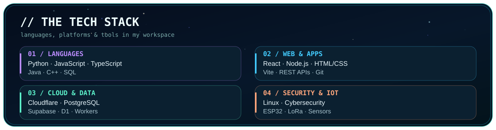
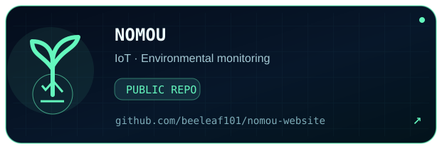
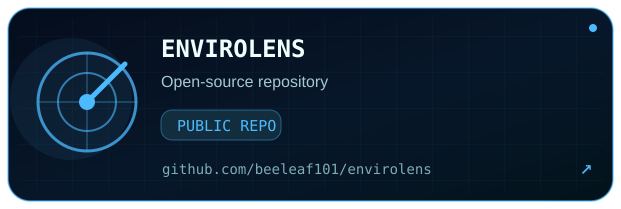
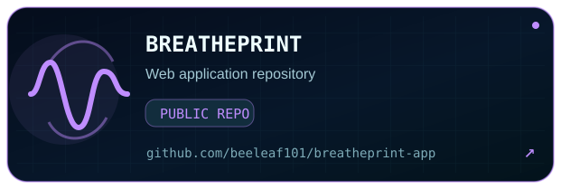
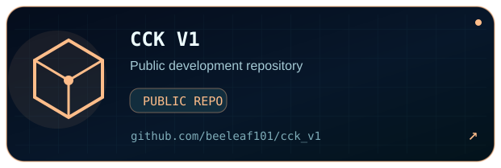
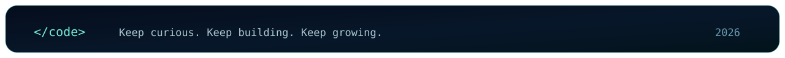

<!-- NEON PROFILE // Crafted for @beeleaf101 -->

 

 

### `> whoami_`

Computer Science developer working across **full-stack development, IoT systems, cloud platforms, and cybersecurity**. I enjoy turning ambitious ideas into practical, working software and hardware — from connected environmental monitoring to expressive AI-driven experiences.

- 🌱 **Building:** [NOMOU](https://github.com/beeleaf101/nomou-website), an environmental monitoring project.
- ☁️ **Exploring:** Cloudflare, distributed systems, creative AI, and secure web applications.
- 🏆 **Milestones:** Enjaz Kuwait Company Program first-place team (CTO); BP × Enjaz hackathon runner-up team.
- ✨ **Philosophy:** *Build things that grow.*

---

### `> live_activity_`

  <!-- Stats are served by a third-party widget; GitHub may occasionally rate-limit it. -->
  
  

### `> contribution_city_`

  
  🌃 Generated from your real GitHub contributions and refreshed automatically every day.

### `> my_technology_`

  

### `> featured_builds_`

<table align="center">
  <tr>
    <td width="50%"></td>
    <td width="50%"></td>
  </tr>
  <tr>
    <td width="50%"></td>
    <td width="50%"></td>
  </tr>
</table>

 

